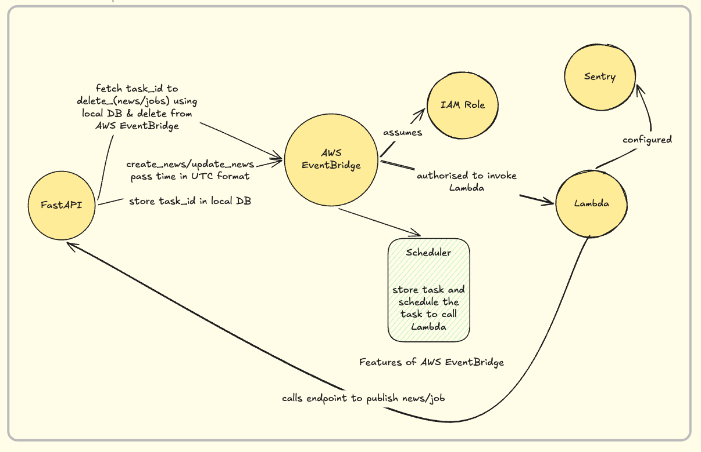
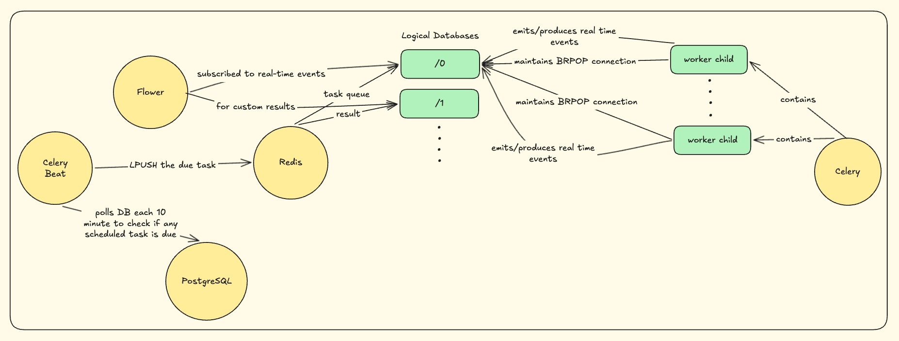
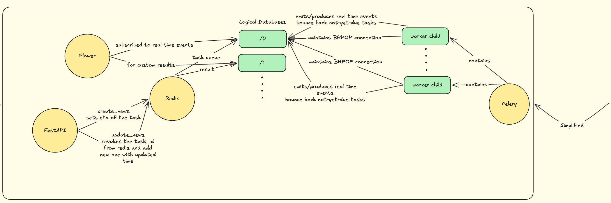

# System Design: Scheduling One-Off Tasks

> **TL;DR:** We schedule one-off jobs with **Amazon EventBridge Scheduler**. When a job is due, Scheduler invokes an **AWS Lambda** function, which calls an internal FastAPI endpoint to do the work. We use it to publish scheduled news and jobs, and to hard delete accounts. Before settling on this, I considered two Celery-based approaches and filtered them out. They're covered briefly at the end.

---

## The Problem

Our news and jobs features support the following actions:

1. Publishing
2. Unpublishing
3. Deleting
4. **Scheduling**

When an admin schedules news or a job, its status has to change from `scheduled` to `published` at the chosen time, and it is then broadcast to all users.

Account deletion has the same shape: when a deletion is requested, the account has to be hard deleted at a set time in the future.

All of these are **one-off jobs that must run at a specific time**, so we built a single scheduling service that handles them all.

---

## Final Architecture: EventBridge Scheduler + Lambda



### Flow

1. **Register:** FastAPI creates a one-time schedule in EventBridge Scheduler for the due time (in UTC). In the same step, it saves a row in our database with the **scheduler name**.
2. **Update / remove:** If the time changes or the job is cancelled, FastAPI looks up the scheduler name and updates or deletes the schedule.
3. **Fire:** When the time arrives, Scheduler assumes an IAM role and invokes our Lambda function. The role follows least privilege: it is only allowed to invoke that function.
4. **Execute:** The Lambda function calls our internal FastAPI endpoint with the `news_id` and an `x-internal-secret` header. The endpoint publishes the news item and broadcasts it to users.

### Why Lambda instead of API Destination

EventBridge offers two ways to reach our API: an **API Destination**, or a **Lambda** function. We chose Lambda because we can run our own code there. In particular, we integrated **Sentry**, so if the FastAPI endpoint is down when a job fires, the error reaches Sentry instead of failing silently.

### Security

- **Least-privilege IAM:** The role Scheduler assumes can only invoke our Lambda function.
- **Internal-only endpoint:** The FastAPI route isn't part of our public API. It rejects any request that doesn't carry a valid `x-internal-secret`, so only our Lambda function can trigger a publish.

### Why no Dead-Letter Queue (DLQ)

EventBridge Scheduler can send failed invocations to a DLQ. We decided it was overkill for now because Sentry already covers the failures we care about:

- **Sentry on Lambda** tells us when the FastAPI endpoint is down or unreachable.
- **Sentry on FastAPI** tells us when something breaks inside the publish logic.

We can add a DLQ later if we need to replay failed jobs.

### Code Design

All EventBridge interaction lives in a single class, `AWSEventBridgeSchedulerService`:

- **Single Responsibility:** The service only creates, updates and deletes future jobs scheduled in UTC. News publishing, job publishing and account deletion all go through it.
- **Encapsulation:** `boto3` calls, payload shape and IAM/target configuration stay inside the class, so callers just ask for a job to be scheduled.
- **Singleton:** One shared instance reuses the same boto3 client, so each request doesn't pay the cost of creating a new client and session.

---

## Approaches I Ruled Out

<details>
<summary><strong>Approach #001: Celery Beat + Redis Broker</strong></summary>



- We have integrated **Celery Beat** which is responsible for scheduling news at its due time, and **Celery Worker** which is responsible for executing the task
- Redis as a broker using two logical databases:
  - `/0` as the task queue — Beat `LPUSH`es tasks into the `/0` when their scheduled time arrives
  - `/1` as the result backend — stores return values of executed tasks temporarily (optional if you want to display the values in terminal/logs)
- Celery Beat polls PostgreSQL every 10 minutes, checks if any scheduled task is due, and if so `LPUSH`es it to Redis. Each worker child holds an open `BRPOP` connection to Redis — when the task arrives, Redis wakes the child that has been waiting the longest and hands it the task for execution
- Flower subscribes (event listener on) to `/0` redis logical DB and it captures the real time event emitted/published by celery as it processes the task. We can also configure different redis logical database `/1` for result to display custom values for our own readability. But real time events always go to the `/0`
  - The following kind of events are published by celery to `/0` database as it process the task:

    ```
    → "task-received"
    → "task-started"
    → "task-succeeded" / "task-failed"
    ```

  - For custom results, Flower does not subscribe to `/1` as it does with `/0`. Instead it performs an on-demand lookup to `/1` using the **task ID** as the key whenever you view a specific task in the dashboard.

**Notes**

- The main pro of BRPOP connection is to keep the celery worker child in sleeping mode and pings it once a new task is arrived. It solves the problem of continuous polling
- In our use case, we allow admins to schedule news in 30 minute intervals. Regardless of timezone differences, only the hour offset differs across regions — minutes and seconds remain perfectly in sync everywhere.
  - We fire the `publish_scheduled_news` task every 10 minutes instead of every minute to avoid overloading PostgreSQL with connections. Each worker child opens its own database connection when executing the task, and if multiple children are running simultaneously each holds a separate connection. Since PostgreSQL has a default `max_connections` limit of 100 — shared across your FastAPI app, worker children, and other services — keeping the task frequency reasonable helps stay within that limit.

</details>

<details>
<summary><strong>Approach #002: Redis-based Task Queue with ETA Check</strong></summary>



- The main problem with **Approach #001** is the consumption of PostgreSQL connections. Since PostgreSQL has a default max connection limit of `100`, there might be cases where multiple celery workers are already holding the PostgreSQL connection. When we receive a new task, another Celery worker has to open a new connection to process it. This can become a bottleneck for FastAPI application that requires frequent PostgreSQL connections.
- We replaced this with Redis-based approach, where we set the ETA of the task and Celery workers access these tasks through `BRPOP` commands. They check the ETA, and if scheduled time has not arrived yet, the task is pushed back to Redis as a pending task.
- Redis offers persistence to some extent, depending on the plan. However, Redis is built as a cache-first service so persisting tasks on redis would not make our solution reliable.
  - To understand this unreliability, we need to first look at how Redis persistence works. It basically takes the snapshot periodically and these snapshots help Redis recover tasks in case of a failure or service restart.
  - There might be a case, that our task is `LPUSH`(ed) at 11:45 AM but snapshot happens at 12:00 and if we restart the service between 11:45 AM ↔ 12:00 PM window that task will be lost

</details>

---
